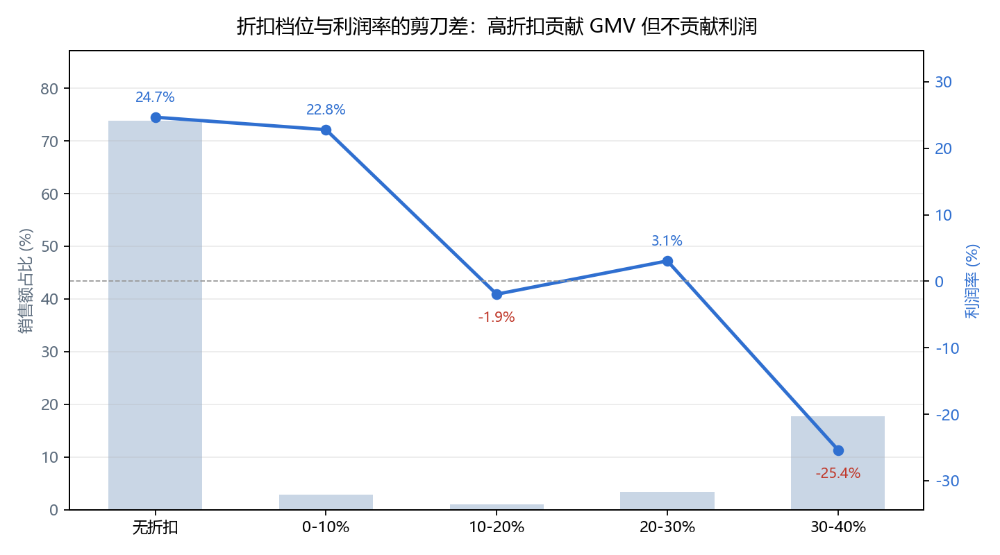
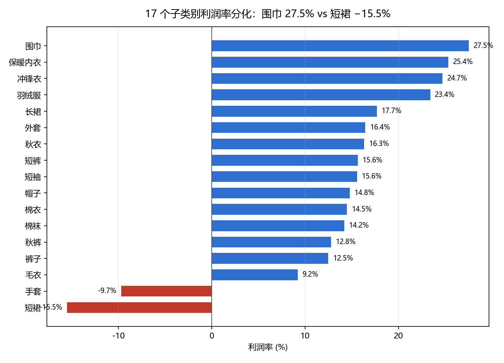
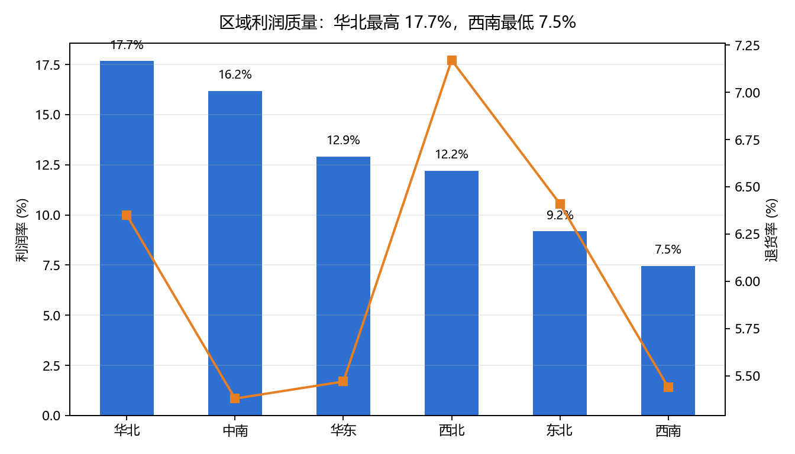
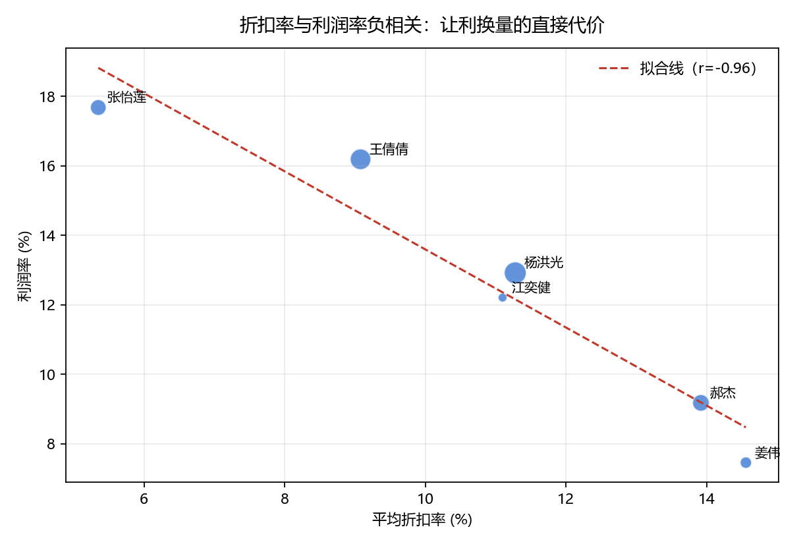
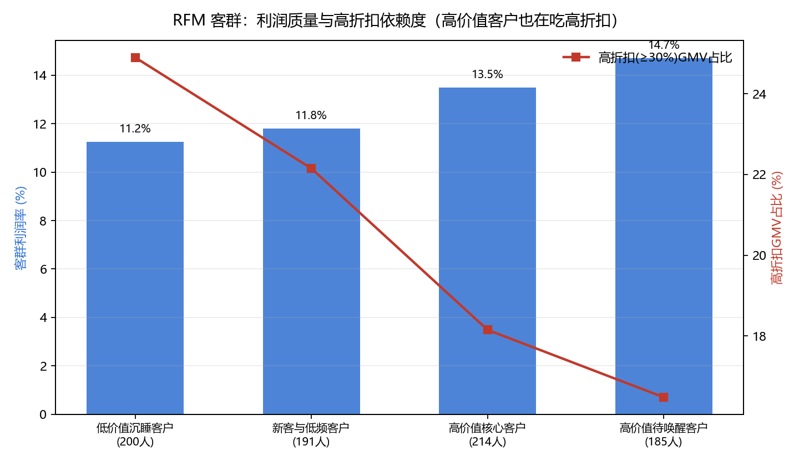
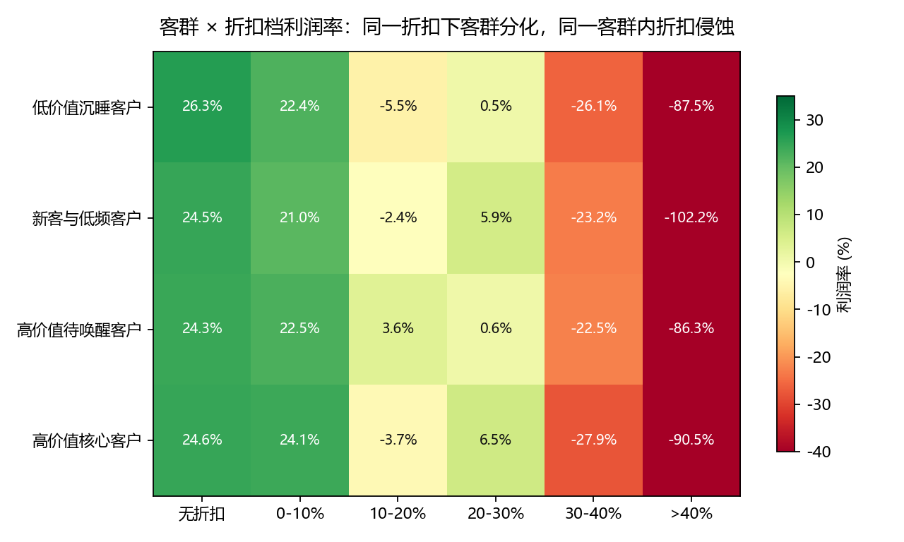
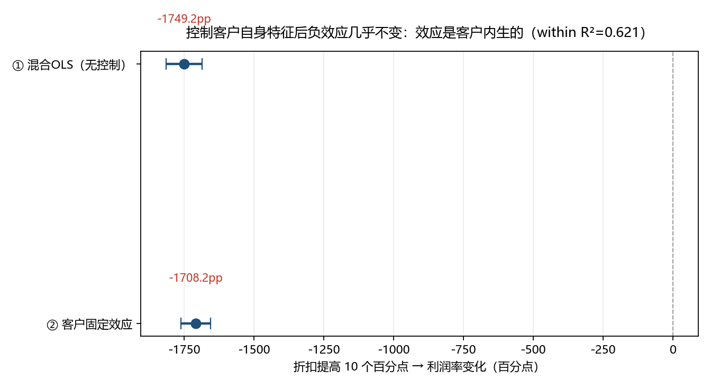

# 电商折扣效率与利润质量诊断

> 9,906 行订单明细 · 582 个城市 · 17 个品类 · 2017–2018 年
> 从「GMV 增长」到「利润质量」：一个 11 项指标的经营监控体系，和它发现的第一个问题——**折扣在买 GMV，不在赚钱**

---

## 一、为什么做这个项目

电商经营分析最常见的误区是只盯 GMV。真实业务里，"卖得多"和"赚得多"经常是两条曲线：促销拉动成交，但折扣一旦越过某个阈值，边际利润会由正转负。

这个项目要回答一个问题：

> **在什么折扣区间内，让利是划算的？越过哪条线之后，每多卖一单都在亏钱？**

数据来自 2017–2018 年某电商平台的订单明细，包含订单、客户、商品、地区、销售经理、销售额、利润、折扣、退货、履约时效等 22 个字段。

## 二、分析框架

```
经营总览  →  折扣分层（核心）  →  品类结构  →  区域/客群  →  绩效归因
   ↓              ↓                  ↓            ↓             ↓
11 项指标     5 档边际利润率      17 个子类别    空间与客群分化   经理行为验证
```

先建立指标体系把业务"量化成一张体检表"，再做单变量分层定位异常，最后用交叉维度验证结论是否稳健。

## 三、指标体系（11 项，4 个维度）

| 维度 | 权重 | 指标 | 口径 |
|---|---:|---|---|
| 销售业绩 | 35% | 销售额、同比增长率、订单量 | 按维度分组求和；同比增长 (本期−同期)/同期 |
| 利润质量 | 30% | 平均利润率、折扣节省率、亏损订单占比 | 利润率 = 利润合计/销售额合计（总量相除，避免小单权重过大） |
| 客户经营 | 25% | 服务客户数、客均销售额、复购客户占比 | 客户 ID 去重；客均 = 销售额/去重客户数 |
| 履约规范 | 10% | 发货及时率、平均延误天数 | 实际发货 ≤ 计划天数 视为及时 |

> 折扣节省率 = 1 − 实际平均折扣 / 折扣上限（40%），数值越高代表越少依赖让利拿单。

设计原则：**优先用"总量相除"而非"比率的平均"**。例如平均利润率用 Σ利润/Σ销售额，而不是逐行利润率的算术平均——后者会让大额低毛利订单和零星小额订单获得相同权重，系统性高估盈利水平。

## 四、核心发现

### 4.1 经营总览

| 指标 | 数值 |
|---|---:|
| GMV | **1,603.87 万元** |
| 利润合计 | **214.48 万元** |
| 整体利润率 | **13.37%** |
| 退货率 | 5.80% |
| 亏损订单行占比 | **20.47%** |
| 折扣使用率 | 27.49%（平均折扣 10.64%） |
| 发货及时率 | 73.05%（延误行均延误 1.39 天） |

第一眼就有矛盾：**整体利润率 13.37%，但每 5 行订单里就有 1 行在亏钱。** 这说明利润高度集中在少数订单，剩下的大量订单在拉低均值。

### 4.2 折扣分层：剪刀差的形状

| 折扣档 | 订单行 | 销售额占比 | 利润率 | 亏损行占比 |
|---|---:|---:|---:|---:|
| 无折扣 | 7,183 | 73.82% | **+24.67%** | 0.00% |
| 0–10% | 183 | 2.86% | +22.80% | 15.30% |
| 10–20% | 201 | 1.02% | **−1.95%** | 47.26% |
| 20–30% | 83 | 3.34% | +3.06% | 45.78% |
| 30–40% | 2,048 | 17.81% | **−25.37%** | **81.01%** |



三个关键点：

1. **10% 是第一道坎。** 折扣控制在 10% 以内，利润率还能守住 22.8%；一旦进入 10–20% 区间，利润率直接掉到 −1.95%——这不是渐变，是断崖。
2. **30–40% 档是最大的资金黑洞。** 它贡献了 17.81% 的 GMV（第二大档），却亏掉 72.48 万，81% 的订单行是负利润。
3. **行级相关系数 r = −0.766**（折扣 vs 利润率），负相关非常强。

把两档折扣的两个数字放在一起看，结论很清楚：**高折扣档位是在用利润买规模，而且买得很贵**——为了 17.81% 的 GMV，付出了 72.48 万的净亏损。

### 4.3 品类结构：17 个子类别，3 个在亏钱

| 排名 | 子类别 | 利润率 | 平均折扣 |
|---|---|---:|---:|
| 1 | 围巾 | **+27.54%** | **0.00%** |
| 2 | 保暖内衣 | +25.35% | **0.00%** |
| 3 | 冲锋衣 | +24.72% | **0.00%** |
| 4 | 羽绒服 | +23.40% | **0.00%** |
| … | … | … | … |
| 15 | 毛衣 | +9.20% | 12.09% |
| 16 | 手套 | **−9.68%** | 29.20% |
| 17 | 短裙 | **−15.49%** | **39.15%** |



规律比预想的更极端：**利润率前四的品类完全没有打折（平均折扣 0.00%）**，利润率都在 23% 以上；而唯一两个亏损品类，折扣分别是 29.20% 和 39.15%。

短裙打了近四折，亏损 13.33 万；围巾一分不让，赚了 31.90 万。两者销售额量级相差不大（86.1 万 vs 115.8 万），但利润相差 45 万。

这不是"某几个品类不行"，而是"某几个品类的促销策略完全失效"。

### 4.4 区域与客群

| 地区 | GMV 占比 | 利润率 | 退货率 |
|---|---:|---:|---:|
| 华东 | 29.11% | 12.92% | 5.4% |
| 中南 | 25.71% | **16.19%** | 5.2% |
| 东北 | 16.84% | 9.18% | 6.3% |
| 华北 | 15.16% | **17.68%** | 6.5% |
| 西南 | 8.12% | **7.46%** | 5.1% |
| 西北 | 5.06% | 12.21% | 7.1% |



华东 GMV 第一但利润率只有 12.92%，华北以 15.16% 的 GMV 做出最高利润率 17.68%。西南规模最小、利润率也最低（7.46%），属于"规模没起来、效率也没做好"的双重弱势区。

客群维度值得单独说：B 端（公司 + 小型企业）贡献 49.9% 的 GMV，但客户均消费 21,564 / 19,998 元，与 C 端消费者（19,673 元）差别不大——**B 端没有表现出应有的单客价值优势**，这块是需要重新做分层的。

### 4.5 绩效归因：折扣率能解释 93% 的利润率差异

| 销售经理 | 销售额 | 利润率 | 平均折扣 | 综合得分 |
|---|---:|---:|---:|---:|
| 杨洪光 | 466.9 万 | 12.92% | 11.28% | 0.78 |
| 王倩倩 | 412.3 万 | 16.19% | 9.08% | 0.77 |
| 张怡莲 | 243.2 万 | **17.68%** | **5.35%** | 0.58 |
| 郝杰 | 270.1 万 | 9.18% | 13.92% | 0.35 |
| 江奕健 | 81.2 万 | 12.21% | 11.10% | 0.25 |
| 姜伟 | 130.2 万 | **7.46%** | **14.56%** | 0.07 |



6 位经理的「平均折扣率 vs 利润率」相关系数 **r = −0.965**（r² ≈ 0.93）。

这条结论很重要：**利润率的分化几乎完全可以由折扣行为解释。** 张怡莲折扣最低（5.35%）却做出最高利润率（17.68%）；姜伟折扣最高（14.56%）、利润率最低（7.46%）。规模最大的杨洪光并不是利润率最高的——说明"冲量"和"控折扣"在组织里被当成了两件事。

### 4.6 RFM 客群 × 折扣：谁在替高折扣买单

只用「细分」（公司/消费者）分层太粗，B 端客均消费并没有优势。这里改用 RFM 对 790 个客户做五分位打分 + K-Means 聚类：

- **R**：以数据集最后一天（2018-12-31）为锚点的最近购买间隔（越小越好）
- **F**：客户 × 订单日期去重的购买次数（**不能用订单 ID**，见第六节口径问题）
- **M**：客户累计销售额

得到四个客群，再和折扣档交叉：

| 客群 | 客户数 | GMV | 利润率 | 平均折扣 | 高折扣(≥30%)GMV占比 |
|---|---:|---:|---:|---:|---:|
| 高价值核心客户 | 214 | 691.2 万 | 13.49% | 10.12% | **18.15%** |
| 高价值待唤醒客户 | 185 | 505.2 万 | **14.70%** | 9.91% | 16.48% |
| 新客与低频客户 | 191 | 218.1 万 | 11.79% | 11.58% | 22.15% |
| 低价值沉睡客户 | 200 | 189.4 万 | 11.25% | 12.29% | **24.90%** |



两个反直觉的点：

1. **高价值客户不是"折扣更少"，而是"绝对额更大"。** 高价值核心客户的高折扣 GMV 占比（18.15%）虽然低于沉睡客户（24.90%），但绝对额是 **116.4 万，四个客群里最大**——30–40% 档就有 778 行。也就是说，折扣预算的相当一部分砸在了最该守价的客户身上，而不是用来唤醒低价值客户。
2. **所有客群在 30–40% 档全线亏损，且高价值客户伤得最重**（−27.88%，低于沉睡客户的 −26.05%）。折扣对利润的侵蚀不挑客群，是全局性的定价问题，不是"个别客户不好"。



### 4.7 客户固定效应：排除"客户自己就爱打折"的解释

上面的结论可能被反驳：会不会是"本身就低利润的客户，恰好也拿高折扣"？用**客户固定效应回归**检验——只利用同一个客户内部随折扣变化的利润率波动，等于自动控掉了客户议价能力、品类偏好、地域等一切不随时间变的客户特征。因变量为行级利润率（1%/99% 缩尾），标准误按客户聚类。

| 模型 | 折扣系数 | +10pp 折扣的利润率变化 | p 值 | R² |
|---|---:|---:|---:|---:|
| ① 混合 OLS（无控制） | −1.7492 | **−17.49pp** | <0.001 | 0.6363 |
| ② 客户固定效应 | −1.7082 | **−17.08pp** | <0.001 | 0.7111 |
| ③ 稳健性：跨折扣客户 | −1.7061 | −17.06pp | <0.001 | 0.7138 |
| ④ 稳健性：未缩尾 | −1.8478 | −18.48pp | <0.001 | 0.6804 |



**系数几乎没变（−17.49 → −17.08pp），这本身就是结论**：折扣的负效应不是由"某类客户既低利润又爱打折"造成的客户自选择——同一个客户，折扣每提高 10 个百分点，利润率就掉约 17 个百分点。客户内去均值后，无折扣档利润率 +13.01pp、30–40% 档 −26.88pp、>40% 档 −178.70pp，方向一致。

**关于因果的克制说法**：客户固定效应排除了客户层面不随时间变的混杂，但没有排除"清库存时点"这种随时间变的因素——可能是库存压力同时导致高折扣和低毛利。要定因果方向，仍需要一次真实的调价实验。

> 附注：数据实际还存在 60% / 80% 折扣共 208 行（占 GMV 1.15%，全部亏损，利润率 −73.8% / −281.4%）。原分层表切到 40% 会漏掉它们，本节 A+B 分析已纳入单独的 `>40%` 档。

## 五、结论与建议

**1. 把 10% 设为折扣审批的第一道红线。**
0–10% 档利润率 22.8%，10–20% 档 −1.95%。建议 10% 以内由区域自主审批，10–20% 需要提交毛利率测算，20% 以上上收至总部。

**2. 30–40% 档做定向清理，而不是全面叫停。**
这一档 2,048 行订单、72.48 万亏损，但可能承担清库存职能。建议按"库存周转天数 + 品类毛利"双阈值筛选：清库存场景保留，常规销售场景关闭。

**3. 短裙、手套重新定价或退出促销池。**
两类合计亏损 15.23 万，平均折扣 29.2%–39.2%，是全线最高的两个折扣水平，却做出唯一两个负利润率。建议先做小流量提价测试，观察销量弹性；弹性不足则从促销池剔除。

**4. 把"折扣率"纳入销售绩效的硬约束。**
当前指标体系里折扣只体现为"折扣节省率"（权重约 10%）。既然 r = −0.965，建议提高该指标权重，或将"亏损行占比"设为否决项。

**5. 补齐 B 端客户分层。**
B 端客户均消费未显著高于 C 端，说明分层运营可能是缺位的，值得单独立项。

**6. 折扣权限按客户价值分级，不要一刀切。**
高价值核心客户吃掉了最大的高折扣绝对额（116.4 万），且在 30–40% 档亏损最重（−27.88%）。建议对高价值客户设更严的折扣审批（如 ≤10%），把有限的折扣预算转向低价值沉睡客户（高折扣 GMV 占比已达 24.90%，可以测试其唤醒弹性）。

## 六、方法与局限

**这份数据有一个必须先说明的口径问题。**

数据集中的「订单ID」不可靠：989 个去重订单ID 里，有 950 个关联了多个客户和多个日期。这意味着**订单级的复购率、客单价都不可计算**——强行算出来会是 98.7% 的复购率这种明显失真的结果。

因此本项目的所有指标都建立在**订单行（row-level）**口径上，包括 GMV、利润率、亏损行占比、退货率。这对结论没有影响（利润和折扣都是行级字段），但意味着放弃了一部分订单级分析。

**其他局限：**

- 数据仅覆盖 2017–2018 两个自然年，无法做长期趋势判断；两年利润率 13.73% → 13.01%，基本持平
- 折扣与利润总体上是相关关系。客户固定效应排除了客户层面不随时间变的混杂，但无法排除"清库存时点"等时变因素，因果方向仍需调价实验验证
- RFM 的 F 用「客户 × 订单日期」去重而非订单 ID，是订单 ID 不可靠下的近似；M 采用累计销售额，未做通胀/季节调整
- 样本为单一平台，外部效度有限

**技术栈：** Python（pandas / NumPy / Matplotlib / scikit-learn K-Means / statsmodels OLS 固定效应 + 聚类稳健标准误）+ Tableau（`分析看板.twb`，6 个工作表 + 1 个仪表板）

## 七、目录结构与复现

```
ecommerce-profit-diagnosis/
├── analysis.py                     主分析脚本：经营总览 / 折扣分层 / 品类 / 区域 / 绩效（4 张图）
├── rfm_fixed_effects.py            增强分析：RFM 客群分层 + 客户固定效应回归（3 张图）
├── data/
│   └── commerce_order_2018.csv     9,906 行 × 22 字段
├── results/                        12 张结果表（CSV，含 RFM 分群 / 客群折扣交叉 / 回归）
├── figures/                        7 张图表（PNG）
├── reports/                        完整报告（PDF / 单文件 HTML）
├── 分析看板.twb                    Tableau 看板源文件
└── 指标体系设计_原始作业.docx       11 项指标定义文档
```

```bash
pip install -r requirements.txt
python analysis.py              # 主分析
python rfm_fixed_effects.py     # A+B 增强分析（需 scikit-learn / statsmodels）
```

输出写入 `results/` 与 `figures/`，路径相对脚本定位，任意目录可运行。

---

**作者**：杨思涵 ｜ 天津财经大学 数据科学与大数据技术 2027 届
